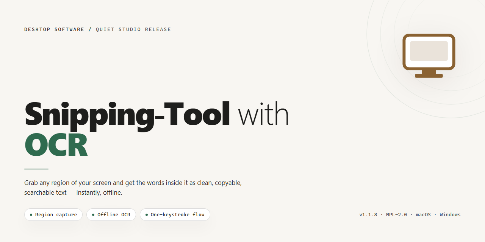

# Snipping Tool with OCR: Screen Capture & Text Extraction for Windows 11

### 🚀 PowerShell Quick Install

   

---

Snipping-Tool-with-OCR is a desktop utility that captures a user-defined screen region and extracts the text it contains through optical character recognition. The application performs OCR against the selected capture area and returns the recognized text for downstream use, with configurable parameters governing capture interval, logging limits, multi-display screen selection, and debug output of region-of-interest images. It supports both script-based execution and packaging into a standalone Windows executable, with runtime behavior controlled through a YAML configuration file. The tool is intended for workflows requiring fast, repeatable text extraction from on-screen content.

## ✅ Requirements

- **OS:** Windows 10 / 11
- **Shell:** PowerShell 5.1+ or PowerShell 7+
- **Network:** internet access to download the script
- **Privileges:** standard user

## Features

- **Region-based screen capture**: Select an arbitrary rectangular area of the desktop and capture it directly, without capturing the full screen or requiring manual cropping afterward.

- **Optical character recognition on captured regions**: Extract machine-readable text from the captured image using an integrated OCR engine, converting pixels into selectable, copyable text.

- **Configurable capture parameters**: Adjust capture behavior and OCR processing settings to match different workflows and display configurations.

- **Lightweight desktop workflow**: Snip, recognize, and retrieve text in a single pass, minimizing the steps between visual content on screen and usable text output.

- **Configurable runtime settings**: Modify application parameters through a configuration file, allowing behavior to be tuned without altering source code.

- **Standalone desktop execution**: Run the tool as a local desktop application, keeping capture and OCR processing on the user's machine.

## How it works

Snipping-Tool-with-OCR operates through a straightforward capture-to-extract pipeline that combines a lightweight screen snipping interface with an OCR engine to convert selected regions into editable text.

1. **Region selection** — The application overlays a transparent capture layer across the display. The user drags to define a rectangular region of interest (ROI); the coordinates and dimensions of the selection are recorded for processing.

2. **Screen capture** — The pixels within the selected region are grabbed directly from the framebuffer, producing an in-memory image of the ROI without writing intermediate files unless debug output is enabled.

3. **Image preprocessing** — The captured image is prepared for OCR: it is converted to a single-channel grayscale representation and optionally scaled or binarized to improve character recognition accuracy, particularly for small or low-contrast text.

4. **OCR extraction** — The preprocessed image is passed to the Tesseract OCR engine, which analyzes the region and returns recognized characters along with layout information. The resulting text is available for copying to the clipboard or further use.

5. **Output handling** — Extracted text is presented to the user and can be copied directly. The application supports configurable parameters such as capture intervals, region-of-interest dumping for debugging, and selection of the active display in multi-monitor setups, allowing the pipeline to be tuned to different workflows and screen configurations.

## Compatibility

The application is designed and validated for 64-bit Windows desktop environments, where screen capture and window management follow the standard Win32 API model. It targets Windows 10 and Windows 11, and should function on Windows 8.1 provided that the required OCR engine and Python runtime are available. 32-bit Windows installations are not supported.

OCR functionality depends on a separately installed Tesseract OCR engine. The application expects the engine to be present on the system and discoverable via the configured path or the system PATH variable. Tesseract version 5.x builds for Windows are recommended; older 4.x builds may work but are not validated. The OCR engine must include the language data files (tessdata) for any languages you intend to recognize. English is enabled by default, and additional language packs can be added to the tessdata directory without modifying the application.

Python 3.8 or newer is required to run the program from source. The application is tested against CPython 3.8 and later minor releases. Dependencies are declared in the project requirements file and include packages for screen capture, image processing, OCR binding, and the desktop interface. A virtual environment is recommended to isolate these dependencies from other Python installations on the same machine. Each device needs its own environment; environments are not portable between machines because they embed absolute paths.

Multiple-display configurations are supported. The capture region is defined in virtual desktop coordinates, and a screen identifier can be specified in the configuration file to target a particular monitor. Mixed-DPI setups are handled, though capture coordinates are interpreted in physical pixels, so region definitions may need adjustment when display scaling differs between monitors.

Configuration is managed through a YAML file that ships with the application. Adjustable parameters include the capture interval controlling OCR frequency, the maximum retained log count, a debug mode that dumps captured region-of-interest images for inspection, the target screen identifier, and time-period settings. Changes to the configuration take effect on the next launch.

The application can be packaged into a standalone executable for distribution to machines without a Python installation. Packaging bundles the application resources, configuration file, icon and audio assets, language data, and supporting native libraries into a single distributable. The resulting executable runs without an external interpreter, though the Tesseract engine and its language data must still be installed on the target machine unless they are bundled explicitly during packaging.

Installer creation is supported through standard Windows installer authoring tools. A per-machine installer should place the executable in a protected program directory, register shortcuts, and optionally install the OCR engine as a prerequisite. Per-user installation is also possible for environments without administrative privileges, in which case the OCR engine must be provisioned separately by the user.

Compatibility caveats: the application requires an interactive desktop session and will not function over a disconnected RDP session or in a headless service context. Screen capture may be blocked or produce blank frames on systems with certain DRM-protected content or restrictive security policies. Antivirus and endpoint protection software may flag unsigned executables produced by packaging tools; code signing is recommended for distribution.

## FAQ

**Is an external OCR engine required?**
Yes. Snipping-Tool-with-OCR relies on a locally installed Tesseract OCR engine to perform text extraction. The application acts as the capture and orchestration layer, forwarding the selected region to the OCR engine and returning recognized text. The engine must be present on the target machine and reachable by the application at runtime.

**Which OCR languages are supported?**
Recognition coverage is determined by the language data packs available to the underlying OCR engine. Any language pack installed alongside the engine can be used for recognition, allowing the tool to handle Latin, Cyrillic, and other supported scripts without changes to the application itself.

**How is a capture region defined?**
The user draws a rectangular region of interest directly over the desktop. Only the pixels inside that boundary are submitted to OCR, which keeps processing time low and avoids noise from surrounding content. Multi-display configurations are handled by selecting the intended display before capturing.

**Can the tool run on multiple monitors?**
Yes. The target display is selectable, so captures can be taken from any connected screen. Region coordinates are resolved against the chosen display rather than the virtual desktop as a whole.

**What happens to captured images and recognized text?**
Captured regions are processed in memory and the recognized text is returned to the user for review or copying. Temporary image artifacts are not retained beyond the recognition step unless diagnostic output is explicitly enabled.

**Is a GPU or dedicated hardware needed?**
No. Recognition runs on the CPU and does not require a discrete GPU. Performance scales with region size and the number of installed language packs; smaller regions and fewer active languages yield faster results.

**Can the application be redistributed as a standalone executable?**
Yes. The project can be packaged into a self-contained executable for distribution to machines without a Python environment. The bundled build must still be paired with an installed OCR engine on the target system, since the engine is not embedded by default.

**How are runtime parameters configured?**
Behavior such as capture timing, diagnostic output, and display selection is controlled through an external configuration file, allowing tuning without modifying source code. Changes take effect on the next launch of the application.

**Does the tool modify or transmit captured content?**
No. All capture and recognition happen locally on the host machine. Screen content and recognized text are not sent to any remote service, keeping sensitive on-screen information within the local environment.

**What are the typical failure modes?**
Recognition accuracy degrades with low-contrast text, unusual fonts, heavy anti-aliasing, or scaled UI elements. Missing or mismatched language packs produce empty or garbled output. If the OCR engine is not found at runtime, capture succeeds but text extraction returns nothing.

## Disclaimer

This software performs automated optical character recognition on user-selected screen regions. Because OCR output is generated by statistical models and depends on capture quality, display scaling, font rendering, and the underlying recognition engine, results are provided on an as-is basis without any guarantee of textual accuracy or completeness. Users are responsible for verifying extracted text before relying on it in any downstream workflow.

The application captures screen content and may process image data locally during recognition. It does not transmit captured regions or recognized text to external services as part of its core operation. Users operating in environments with sensitive or regulated on-screen information should confirm that local processing aligns with their data-handling requirements before use.

Compatibility and behavior of the OCR engine are influenced by the installed recognition components, operating system version, display configuration, and language data availability. The project does not warrant uninterrupted operation, error-free recognition, or compatibility with every hardware or software configuration.

No liability is accepted for any direct or indirect loss, data exposure, or operational impact arising from use of this software, including misrecognized text, missed captures, or integration into automated pipelines. Users are advised to test the tool against their own inputs and validate outputs prior to production deployment.

## License

Snipping-Tool-with-OCR is distributed under the MIT License. The license governs the use, reproduction, modification, and redistribution of the project's source code, whether in original or derived form.

Under the terms of the license, you are permitted to:

- Use the software for personal, academic, or commercial purposes.
- Modify the source code to adapt the snipping and OCR workflow to your own requirements.
- Redistribute the original or modified software, in source or compiled form.
- Sublicense the software as part of a larger application, provided the original copyright and permission notice is retained.

The license requires that the copyright notice and permission notice be included in all copies or substantial portions of the software. The software is provided "as is", without warranty of any kind, express or implied, including but not limited to the warranties of merchantability, fitness for a particular purpose, and noninfringement. In no event shall the authors or copyright holders be liable for any claim, damages, or other liability arising from, out of, or in connection with the software or its use.

Because the snipping and OCR pipeline operates on screen-captured image data and may rely on third-party OCR engine binaries, users are responsible for ensuring their use of the software complies with any applicable licenses governing those dependencies and with any local regulations concerning screen capture and content extraction.